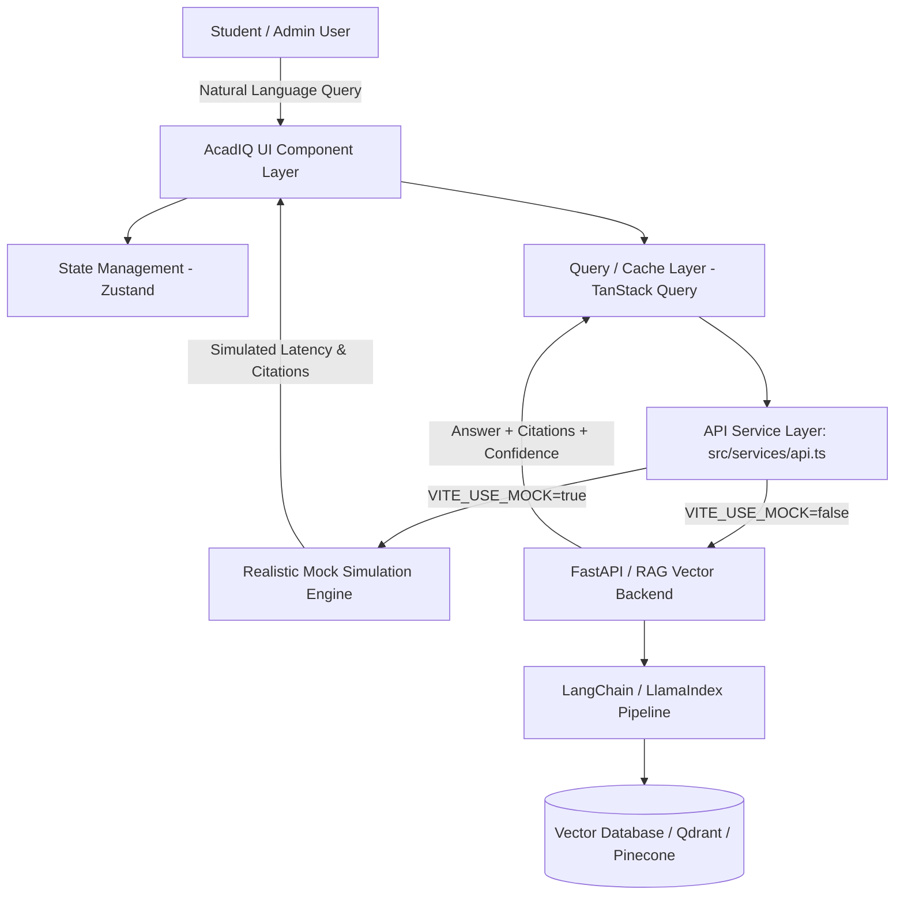

# AcadIQ — RAG-Based Academic Query Assistant

<p align="center">
  
  
  
  
  
  
</p>

> **Phase 1 — Complete Frontend & Mock API Engine.**  
> A high-performance, university knowledge assistant built with React 19, TypeScript, and a ChatGPT-inspired monochromatic design system. Designed to plug directly into a Phase 2 Retrieval-Augmented Generation (RAG) backend via a single environment variable toggle.

---

## 📌 Table of Contents

- [Overview](#-overview)
- [Key Features](#-key-features)
- [Architecture & Data Flow](#-architecture--data-flow)
- [Design System (ChatGPT Black & White)](#-design-system-chatgpt-black--white)
- [Tech Stack](#-tech-stack)
- [Getting Started](#-getting-started)
- [Environment Variables](#-environment-variables)
- [Role-Based Access Control (RBAC)](#-role-based-access-control-rbac)
- [Folder Structure](#-folder-structure)
- [Mock vs. Real Backend API Integration](#-mock-vs-real-backend-api-integration)
- [API Contract Specification (Phase 2 Backend)](#-api-contract-specification-phase-2-backend)
- [Contributing & License](#-contributing--license)

---

## 🌟 Overview

**AcadIQ** solves the information discovery challenge in universities by allowing students and faculty to ask natural-language questions about institutional regulations:
- **Academics**: Syllabus, examination regulations, grading systems, attendance rules.
- **Administrative**: Fee schedules, scholarship criteria, refund policies.
- **Campus Life**: Hostel rules, anti-ragging policies, library guidelines.
- **Career**: Placement rules, internship criteria, company drive guidelines.

The assistant returns responses **with verifiable source citations** (document name, page number, confidence rating, and matched snippets) retrieved from institutional documents. Administrators have a dedicated dashboard to upload documents, manage vector indexing, and analyze query analytics.

---

## ✨ Key Features

### 1. 💬 ChatGPT-Style Academic Chat
- **Monochromatic Interface**: High-contrast, distraction-free conversational canvas with clean typography and rounded input cards.
- **Simulated Streaming**: Real-time word-by-word streaming animation simulating LLM output.
- **Source Citations**: Interactive source chips under each response showing document name, page number, and similarity score.
- **Source Inspection Drawer**: Clicking a citation slides out a document viewer panel with highlighted text excerpts.
- **Confidence Metrics**: High / Medium / Low confidence badges for academic reliability.
- **Rich Markdown Formatting**: Supports formatted code snippets, bold academic notices, structured tables, and blockquotes.
- **Feedback & Regeneration**: Copy to clipboard, regeneration, and thumbs-up / thumbs-down ratings.
- **Conversation Management**: Searchable chat history, new chat creation, title editing, and deletion.
- **Query Filtering**: Granular filtering by category (Syllabus, Exam Rules, Fees), department, and semester.

### 2. 📂 Document Management Center (Admin)
- **Drag-and-Drop Uploader**: Supports PDF, DOCX, and TXT files up to 50MB with animated upload progression.
- **Metadata Tagging**: Associate uploads with categories, departments, and semesters.
- **Document Index Table**: Search, filter by status (`indexed`, `processing`, `failed`), sort by file size or date, and pagination.
- **Document Operations**: One-click re-indexing trigger and secure document deletion modal.

### 3. 📊 Analytics & Insights Dashboard (Admin)
- **KPI Metrics**: Total Queries, Active Users, Indexed Documents, Average Response Time, and Student Satisfaction Rate with weekly trend indicators.
- **Visual Analytics (Recharts)**:
  - *Queries Over Time*: Interactive line chart showing daily query volume vs. unique users.
  - *Feedback Distribution*: Radial pie breakdown of student ratings.
  - *Queries by Category*: Horizontal bar chart highlighting popular query topics.
- **Quality Assurance**: Lists top asked queries and low-confidence queries needing administrative documentation review.

### 4. 🌗 ChatGPT Black & White Aesthetic
- Full support for **Light**, **Dark**, and **System** themes.
- Re-mapped to authentic ChatGPT dark charcoal (`#212121`), sidebar charcoal (`#171717`), and crisp white/black primary accents.

---

## 📐 Architecture & Data Flow



---

## 🎨 Design System (ChatGPT Black & White)

AcadIQ follows OpenAI's signature design principles:

| Element | Light Mode | Dark Mode |
|---|---|---|
| **App Canvas** | `#ffffff` (Pure White) | `#212121` (Signature Charcoal) |
| **Sidebar / Cards** | `#f9f9f9` (Off-white) | `#171717` (Deep Neutral) |
| **User Message Bubble** | `#f4f4f4` (Light Gray) | `#2f2f2f` (Elevated Charcoal) |
| **Primary Buttons** | `#0d0d0d` (Solid Black) | `#ffffff` (Solid White) |
| **Borders** | `#e5e5e5` (Soft Gray) | `#303030` (Subtle Dark Border) |
| **Text Primary** | `#0d0d0d` (Rich Black) | `#ececec` (High Contrast White) |
| **Text Muted** | `#8e8e8e` (Medium Gray) | `#737373` (Muted Gray) |
| **Typography** | `Inter`, system-ui, sans-serif | `Inter`, system-ui, sans-serif |

---

## 💻 Tech Stack

- **Core**: React 19, TypeScript 6, Vite 8
- **Styling**: Tailwind CSS v4, Vanilla CSS Design Tokens
- **Icons**: [Lucide React](https://lucide.dev/)
- **Primitives**: Radix UI (Dropdown Menu, Dialog, Tooltip)
- **State Management**: [Zustand v5](https://github.com/pmndrs/zustand)
- **Data Fetching**: [TanStack Query v5](https://tanstack.com/query)
- **Charts**: [Recharts](https://recharts.org/)
- **Animations**: [Framer Motion](https://www.framer.com/motion/)
- **Form Handling**: React Hook Form + Zod
- **Markdown**: `react-markdown` + `remark-gfm`
- **File Uploading**: `react-dropzone`

---

## 🚀 Getting Started

### Prerequisites
- Node.js (v18 or higher recommended)
- npm, yarn, or pnpm

### Installation

1. **Clone the repository:**
   ```bash
   git clone https://github.com/Shivansh1146/5th-Sem-Project.git
   cd 5th-Sem-Project
   ```

2. **Install dependencies:**
   ```bash
   npm install
   ```

3. **Configure Environment Variables:**
   ```bash
   cp .env.example .env
   ```

4. **Start the local development server:**
   ```bash
   npm run dev
   ```
   Open [http://localhost:5173](http://localhost:5173) in your browser.

5. **Type checking:**
   ```bash
   npm run build
   ```

---

## 🔑 Role-Based Access Control (RBAC)

The application includes built-in role simulation. On the **Login** and **Sign Up** pages, select your role:

| Role | Access Level | Available Routes |
|---|---|---|
| **Student** | Academic query access, citation reading, feedback | `/`, `/chat`, `/chat/:id`, `/settings` |
| **Admin** | Full student capabilities + document indexing & system analytics | `/`, `/chat`, `/chat/:id`, `/settings`, `/admin/documents`, `/admin/analytics` |

> *Note: In mock mode, entering any valid format email/password will authenticate successfully with the selected role.*

---

## 📁 Folder Structure

```
5th-Sem-Project/
├── public/                 # Static assets & favicons
├── src/
│   ├── components/         # Reusable design system components
│   │   ├── common/         # ThemeProvider, ErrorBoundary, Toast
│   │   └── ui/             # Button, Input, Badge, Dialog, Skeleton, Tooltip
│   ├── features/           # Feature-specific modules
│   │   ├── auth/           # ProtectedRoute, role authorization guards
│   │   ├── chat/           # MessageBubble, InputBar, CitationChip, SourcePanel, Sidebar
│   │   └── documents/      # DropZone, Document table row actions
│   ├── layouts/            # AppLayout (Sidebar + Main) & AuthLayout
│   ├── lib/                # Constants, helpers, utility functions
│   ├── mocks/              # Mock dataset for university queries & documents
│   ├── pages/              # LandingPage, ChatPage, DocumentsPage, AnalyticsPage, etc.
│   ├── services/           # API abstraction layer (Mock vs Real HTTP client)
│   ├── store/              # Zustand stores (Auth, Theme, Chat)
│   ├── types/              # Comprehensive TypeScript interfaces
│   ├── App.tsx             # Root router configuration
│   ├── index.css           # Tailwind v4 theme tokens & markdown styling
│   └── main.tsx            # React application entry point
├── .env.example            # Environment template
├── tsconfig.json           # TypeScript configuration
├── vite.config.ts          # Vite bundler configuration
└── README.md
```

---

## 🔌 Mock vs. Real Backend API Integration

The application is architected so that **zero frontend UI components** need to change when connecting your Python / FastAPI RAG backend in Phase 2:

1. Open `.env`
2. Change `VITE_USE_MOCK` to `false`:
   ```env
   VITE_USE_MOCK=false
   VITE_API_BASE_URL=http://localhost:8000/api/v1
   ```
3. All service calls in `src/services/api.ts` automatically switch to real HTTP REST requests with automatic JWT Bearer token injection.

---

## 📋 API Contract Specification (Phase 2 Backend)

Your Phase 2 backend (e.g. FastAPI + LangChain/LlamaIndex) should implement the following endpoints:

### Authentication
- `POST /auth/login` → `{ email, password, role }` → Returns `{ user, token }`
- `POST /auth/signup` → `{ name, email, password, role }` → Returns `{ user, token }`

### Chat & Retrieval
- `GET /chats` → Returns array of chat summaries.
- `POST /chats` → Create new conversation.
- `GET /chats/:id` → Retrieve conversation history with message citations.
- `POST /chats/:id/query` →
  ```json
  {
    "query": "What is the passing criteria for Semester 5 End Terms?",
    "filters": {
      "category": "Exam Rules",
      "department": "Computer Science",
      "semester": 5
    }
  }
  ```
  Returns:
  ```json
  {
    "userMessage": { "id": "msg-1", "content": "..." },
    "assistantMessage": {
      "id": "msg-2",
      "content": "According to Section 4.2 of the Examination Regulations...",
      "confidence": "high",
      "citations": [
        {
          "id": "cit-1",
          "documentName": "Exam_Regulations_2024.pdf",
          "pageNumber": 14,
          "relevanceScore": 96,
          "snippet": "Students must secure a minimum of 40% in internal and external...",
          "matchedText": "40% in internal and external"
        }
      ]
    }
  }
  ```
- `POST /feedback` → `{ messageId, value: "up" | "down" }`

### Documents & Indexing
- `GET /documents` → Query parameters: `search`, `category`, `department`, `page`, `pageSize`, `sortBy`, `sortDir`.
- `POST /documents/upload` → `multipart/form-data` with `file`, `category`, `department`.
- `POST /documents/:id/reindex` → Triggers embedding recalculation in vector store.
- `DELETE /documents/:id` → Removes file and vectors.

### Analytics
- `GET /analytics` → Returns KPIs, query volume timelines, feedback distributions, and top/low confidence questions.

---

## 📜 Contributing & License

This project was created for the 5th Semester University Capstone. Contributions, feature proposals, and pull requests are welcome.

Distributed under the **MIT License**. See `LICENSE` for more information.
